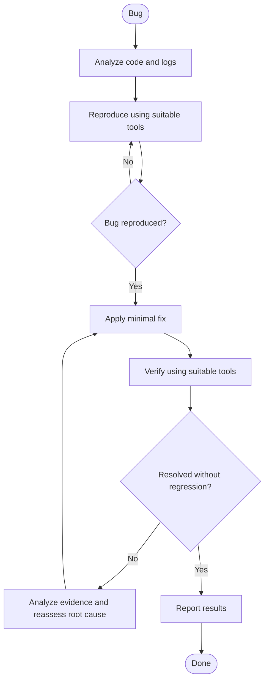

# Bug Fix

Fix bugs autonomously without asking questions or waiting for approval.

## Arguments

- `max_turns`: Maximum attempts per phase. Default: `5`. Must be a positive integer. If invalid, report the invalid value and stop.

## Suitable Tools

Use tools as appropriate to the bug; not every tool is required.

- Playwright MCP
- Python
- curl
- CLI tools
- Tests
- Logs
- Build tools

## Workflow

## Rules

- Reproduce the bug before changing code.
- If the bug cannot be reproduced within the attempt limit, do not attempt a fix; report the failure and available evidence.
- Identify the root cause and apply the smallest effective fix.
- Use tests that exercise the real code path; mock only external dependencies when appropriate.
- Never weaken, skip, or delete tests to make them pass.
- Validate `max_turns` before starting. Apply it independently to the reproduction phase and the fix-and-verify phase; each phase has its own counter.
- Each reproduction attempt counts as one turn. Each fix-and-verify iteration, including one fix followed by verification, counts as one turn. The initial attempt counts toward the limit.
- When either phase reaches its limit without success, stop and report the outcome, evidence, and unresolved issues.
- If verification fails, analyze the evidence and reassess the root cause before attempting another fix.
- Never claim success without verification.
- If tools or infrastructure are unavailable, complete possible checks and report limitations.

## Report

Summarize the root cause, changes made, attempts used in each phase, verification results, and unresolved issues or limitations.