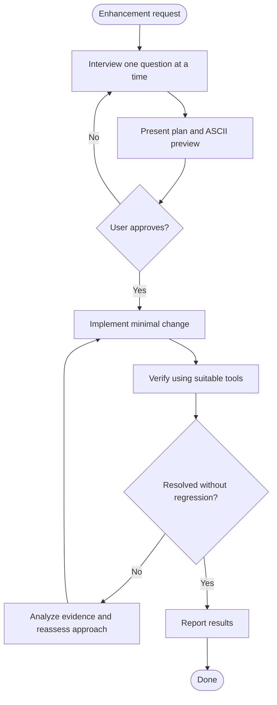

# Enhancement

## Arguments

- `max_turns`: Maximum implementation-and-verification attempts. Default: `5`. Must be a positive integer. If invalid, report the invalid value and stop.

## Suitable Tools

Use tools as appropriate to the enhancement; not every tool is required.

- Playwright MCP
- Python
- curl
- CLI tools
- Tests
- Logs
- Build tools

## Workflow

## Step 1: Interview and Plan

Announce:

`Current Step: Step 1 Interview Next Step: Step 2 Enhance`

- Ask one question at a time until requirements and key decisions are clear.
- Explore relevant dependencies, edge cases, and assumptions.
- Avoid questions already answered or resolvable by inspecting the code.
- Do not use the AskUserQuestion tool.
- Provide ASCII mock previews for UI choices. For non-UI changes, use a flow or request/response example where useful.
- Present the plan in this format:

### Plan

**ASCII Mock Preview (Before/After)**

Show the proposed UI or behavior.

**Components Affected**
- Relevant component and file paths.

**Views Affected**
- Relevant pages, services, endpoints, or data flows.

**Implementation and Verification**
- Planned changes, tests, suitable tools, and known risks.

Wait for explicit user confirmation before implementation. If the scope changes materially, update the plan and obtain confirmation again.

## Step 2: Enhance

Announce:

`Current Step: Step 2 Enhance Next Step: Done`

- Inspect the existing code, conventions, and current behavior before making changes.
- Apply the smallest change that satisfies the approved plan.
- Verify relevant behavior and check for regressions.
- If verification fails, analyze the evidence and reassess the approach before retrying.

## Rules

- Do not implement before plan approval.
- Validate `max_turns` before implementation. Each implementation-and-verification iteration, including one change followed by verification, counts as one turn. The initial attempt counts toward the limit.
- When the phase reaches its limit without success, stop and report the outcome, evidence, and unresolved issues.
- Never weaken, skip, or delete tests to force success.
- Do not expand the approved scope without confirmation.
- Never claim success without verification.
- If tools or infrastructure are unavailable, complete possible checks and report limitations.

## Report

Summarize the changes, affected files, attempts used, verification results, and unresolved issues or limitations.