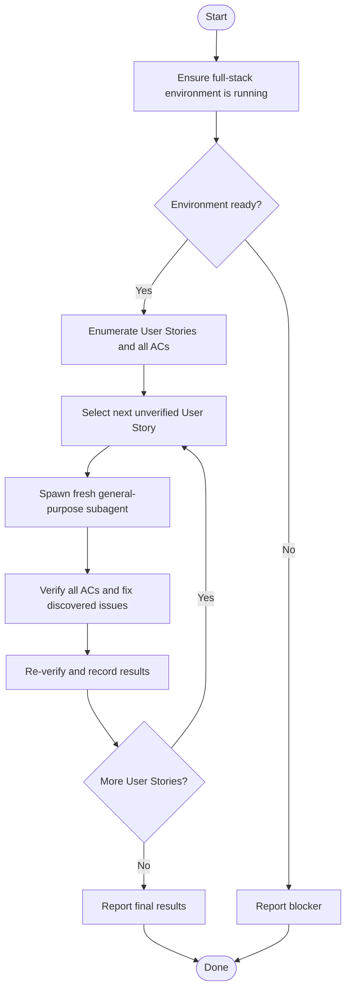

# Feature E2E Verifier

## Suitable Tools

Use these tools for verification and debugging as appropriate; not every tool is required.

- Playwright MCP
- Python
- curl
- CLI tools
- Tests
- Logs
- Build tools

## Workflow

## Rules

- Ensure the full-stack environment is running before verification. Start it if needed; if it cannot be started, report the blocker and stop.
- Enumerate all User Stories and their complete Acceptance Criteria from the provided context or specification.
- Use a separate, fresh `general_purpose` subagent for each User Story.
- Pass the complete User Story, all its Acceptance Criteria, and relevant project context to the subagent.
- Require each subagent to use the suitable tools listed under **Suitable Tools** for verification and debugging. Select tools based on the task; not every tool is required.
- Wait for each subagent to finish before starting the next. Never verify User Stories in parallel.
- Verify every Acceptance Criterion for the current User Story in the same subagent run.
- If an issue is found, investigate, apply the smallest appropriate fix, and re-verify the affected behavior using suitable tools.
- Record each Acceptance Criterion as passed, failed, or blocked, along with fixes and relevant evidence.
- Mark a User Story as verified only when all its Acceptance Criteria pass. Otherwise, report unresolved issues.

## Report

Summarize each User Story, the result of each Acceptance Criterion, fixes applied, and unresolved issues. State whether all User Stories are verified or list the remaining failures and blockers.