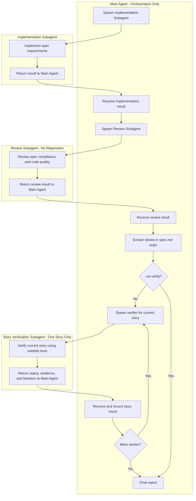

# Suitable Tools

Use tools as appropriate to each story's acceptance criteria; not every tool is required.

- Playwright MCP
- Python
- curl
- CLI tools
- Tests
- Logs
- Build tools

# Workflow

Parse `$ARGUMENTS`: it may contain a spec path, a number (`max_turns`, the skill-wide budget, default `10`), and/or the flag `--no-verify`, in any order. When `--no-verify` is present, skip the Story Verification phase entirely; everything else runs unchanged. Read the spec — the given path, or `docs/sdd/features/<feature>/spec.md` by default.

# Rules
- Main Agent orchestrates, runs the baseline checks before any change, and produces the final report.
- `max_turns` is one shared budget covering the entire workflow; implementation, review, fixes, and per-story verification all consume from it. When it is reached, stop all work and report completed and unfinished tasks honestly.
- Every subagent returns findings, check results, evidence, and blockers to Main Agent. Subagents never call other subagents.
- Run subagents sequentially, never in parallel.
- Each verification subagent handles exactly one user story.
- Verify actual behavior, not just source code, build success, or existing test results.
- On failure, fix the current story and reverify it.
- Never finish a stage while existing checks fail; after every fix, rerun applicable checks and repeat until they pass.
- The review subagent fixes the findings it discovers before returning its result.
- No regression: do not restart completed stages or reverify previously passed stories after later fixes.
- Before making changes, read the spec and run the project's existing checks as a baseline; if any baseline check fails, make no changes and stop.
- Run only existing checks discovered from project scripts, documentation, and CI (applicable tests, lint, type-check, and build commands); skip missing ones and never create tests or check scripts.
- Never weaken acceptance criteria or claim unverified success.
- Report each story as `verified`, `failed`, `blocked`, or `unverifiable`, with evidence and blockers; explain why when it is `unverifiable`.
- When verification is skipped via `--no-verify`, baseline and implementation checks still run; report every story as `not verified` in the final report and state clearly that no E2E evidence exists. `not verified` is never reported as `verified`.