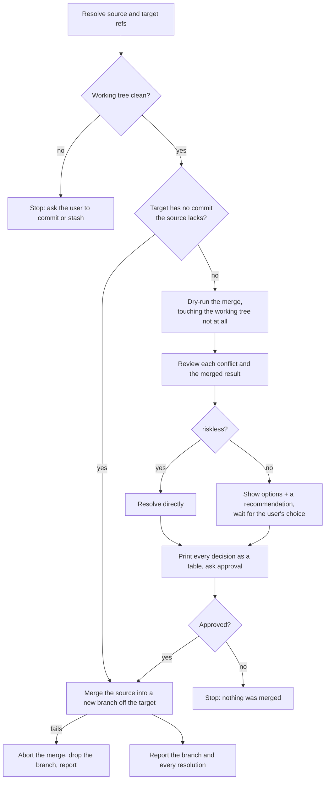

# merge

Merges the **source** branch from `$ARGUMENTS` with the **target** branch into a reviewable integration branch, reconciling conflicts on the way, and leaves the target branch itself untouched.

## Input

- **source** (required): the branch merged in, e.g. `feature/login`.
- **target** (optional): the branch merged into; default is the current branch.
- **language** (optional, `--lang <language>`): the language the session runs in — the plan table, the questions and the reports; default is the language the user writes in.

## Flow

## Rules

**Setup** — Both refs must resolve to branches and the working tree must be clean; otherwise report and stop.

**Branch** — All the merge work goes on `merge/<source>-into-<target>`, branched from the target; the target branch itself is never modified.

**Classify** — every conflict (base / ours / theirs), and the merged result as a whole:
- *Riskless* — resolve it yourself: the sides do not interact, or the change is mechanical.
- *Risky* — the user decides: the sides touch the same behavior or contract, or the merge leaves something broken or inconsistent. Unsure counts as risky.

**Ask when it is the user's call** — one per turn, never batched: base/ours/theirs, then 2-3 options with the one you recommend, then the user's choice. Never decide it for them.

**Plan, then merge** — Show **every** decision — the ones you resolved and the ones the user chose — in a table: *Area / file | Status | Finding | Decision | Risky?* (`Risky?` is yes when the user decided, no when you did). Then wait for approval, and on approval build the merge on the integration branch.

**After** — Report the integration branch and every resolution. Landing it on the target is the user's later step, and a fast-forward one, since the branch descends from the target.

**Limits** — Never push and never touch the target branch; the only commits are the ones the merge itself writes on the integration branch. What the merge breaks is fixed with it, never deferred as a follow-up.
